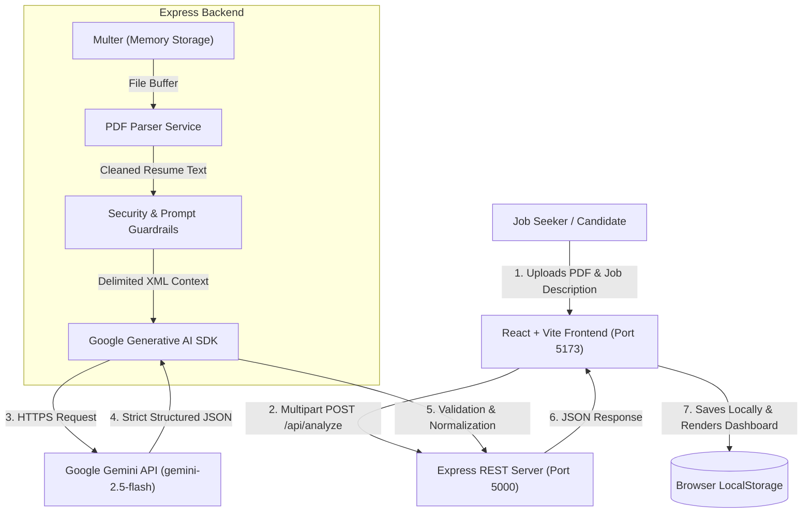

# CareerMatch AI — AI-Powered Resume & Job Description Analyzer

**CareerMatch AI** is a production-grade full-stack web application built on the MERN stack and Google Generative AI (Gemini). It helps students, freshers, and job seekers evaluate how well their resume aligns with a specific job description through evidence-grounded scoring, transparent skill gap analysis, keyword coverage evaluation, and fact-preserving resume bullet rewrites.

> **Advisory Disclaimer:** CareerMatch AI produces an estimated compatibility score based on defined recruitment criteria. It does not claim to be an official ATS scoring system or guarantee employment or interview selection.

---

## 🌟 Key Features

### 1. In-Memory Resume Parsing
- **PDF-Only Support:** Validates `%PDF-` file signatures and extracts text using in-memory stream parsing.
- **Scanned Document Detection:** Accurately detects empty or image-only scanned PDFs without OCR text and prompts the user with clear instructions.
- **Zero Disk Retention:** Files are processed in memory and immediately garbage-collected to safeguard candidate privacy.

### 2. Evidence-Based AI Alignment Engine
- **5-Pillar Scoring Model (0–100 points):**
  - **Required Core Skills (40%)**: Matches essential technical stack and frameworks.
  - **Relevant Experience & Projects (25%)**: Assesses practical project depth and complexity.
  - **Education & Qualifications (15%)**: Evaluates degree alignment and certifications.
  - **Terminology & Keywords (10%)**: Measures domain vocabulary coverage.
  - **Evidence of Achievements (10%)**: Checks for measurable contributions and ownership.
- **Skill Gap Nuance:** Distinguishes between completely missing skills vs. skills that are present but insufficiently demonstrated.
- **Strict Anti-Hallucination Guardrails:** AI prompts are strictly forbidden from inventing skills, employment history, metrics, or credentials not present in the resume.
- **Prompt Injection Defense:** Resumes and job descriptions are isolated as untrusted data within XML boundaries.

### 3. Interactive Resume Bullet Assistant
- Strengthens individual resume bullet points based on four distinct user goals:
  - *Make it more concise*
  - *Improve clarity & high-impact action verbs*
  - *Emphasize relevant technical skills*
  - *Align wording with target job description*
- Shows side-by-side comparisons with one-click copy to clipboard.
- Enforces strict factual preservation (never fabricates numbers or tools).

### 4. Privacy & Local-First History
- **Local Storage:** All past analysis reports are saved in the user's browser `localStorage`.
- **Zero External Tracking:** No mandatory account creation or public databases.
- **Data Export & Control:** One-click JSON export and full history clearing at any time.

---

## 🛠️ Technology Stack

| Layer | Technologies |
| :--- | :--- |
| **Frontend** | React 19, Vite, Tailwind CSS v4, React Router DOM v7, Axios, Lucide React, Recharts |
| **Backend** | Node.js (v20+), Express.js, Multer (memory storage), `pdf-parse` v2, `@google/generative-ai`, `@google/genai` |
| **AI Provider** | Google Gemini (`gemini-2.5-flash` or `gemini-1.5-flash`) via official SDK |
| **Security** | Helmet HTTP headers, CORS origin filtering, `express-rate-limit`, XML data boundary isolation |

---

## 🏛️ Architecture & Request Flow



---

## 📋 Prerequisites

- **Node.js**: v20.0.0 or later (Tested on Node v22.19.0)
- **NPM**: v10.0.0 or later
- **Google Gemini API Key**: Free tier key available from [Google AI Studio](https://aistudio.google.com/app/apikey)

---

## 🚀 Installation & Setup

### 1. Clone or Open the Repository
```bash
cd CareerMatch-AI
```

### 2. Configure Environment Variables
Copy the example environment file into `server/.env`:

```bash
# On Windows PowerShell:
Copy-Item server/.env.example server/.env

# On Mac / Linux:
cp server/.env.example server/.env
```

Open `server/.env` and insert your Google Gemini API key:
```env
PORT=5000
NODE_ENV=development
CLIENT_URL=http://localhost:5173
GEMINI_API_KEY=AIzaSy...your_actual_key_here
GEMINI_MODEL=gemini-2.5-flash
MAX_FILE_SIZE_MB=5
```

> **Note:** If `GEMINI_API_KEY` is omitted, the server will start up normally and report its health status. When an analysis is submitted, it will return a friendly `503 API_KEY_MISSING` message explaining how to configure the key, rather than hallucinating fake mock data.

### 3. Install Dependencies

**Install Backend Dependencies:**
```bash
cd server
npm install
cd ..
```

**Install Frontend Dependencies:**
```bash
cd client
npm install
cd ..
```

---

## 💻 Running the Application

Open two terminal windows (or tabs):

### Terminal 1: Backend Server
```bash
cd server
npm run dev
```
*The server will start at `http://localhost:5000` with live reload.*

### Terminal 2: Frontend Client
```bash
cd client
npm run dev
```
*Vite will start the client at `http://localhost:5173`.*

Open `http://localhost:5173` in your browser.

---

## 🧪 Testing & Verification

A comprehensive test suite is included in `server/test/`:

```bash
cd server
npm test
```

This runs:
1. `sample_test.js`: Validates PDF buffer parsing, non-PDF rejection, and empty PDF detection.
2. `e2e_api_test.js`: Tests `/api/health`, missing file validation, bullet length checks, API key missing handling, and 404 responses.
3. `upload_test.js`: Simulates a complete multipart PDF upload of `sample_resume.pdf` to `/api/analyze`.

To generate a sample test PDF resume:
```bash
cd server
node test/generate_sample_pdf.js
```
The file will be created at `server/test/sample_resume.pdf` and can be uploaded directly into the web UI.

---

## 📡 REST API Documentation

### 1. Health Check
- **Endpoint:** `GET /api/health`
- **Description:** Verifies backend status, uptime, active model, and whether an AI key is loaded.
- **Response:**
```json
{
  "success": true,
  "status": "healthy",
  "aiConfigured": true,
  "model": "gemini-2.5-flash",
  "version": "1.0.0"
}
```

### 2. Analyze Resume Alignment
- **Endpoint:** `POST /api/analyze`
- **Content-Type:** `multipart/form-data`
- **Rate Limit:** 30 requests per 15 minutes per IP
- **Fields:**
  - `resume` *(File, required)*: PDF resume up to 5 MB
  - `jobDescription` *(String, required)*: Complete job posting (30–25,000 characters)
  - `targetRole` *(String, optional)*: Desired job title
  - `companyName` *(String, optional)*: Target company
  - `experienceLevel` *(String, optional)*: E.g., `Fresher`, `Entry Level`, `Intermediate`
- **Response Structure:**
```json
{
  "success": true,
  "data": {
    "matchScore": 82,
    "scoreBand": "Strong Match",
    "scoreBreakdown": {
      "requiredSkills": 34,
      "experienceAndProjects": 21,
      "educationAndQualifications": 12,
      "keywordsAndTerminology": 8,
      "achievementsEvidence": 7
    },
    "executiveSummary": "...",
    "matchingSkills": [
      {
        "name": "React",
        "evidence": "Built responsive components with Tailwind CSS",
        "relevance": "Direct match for frontend stack requirement"
      }
    ],
    "missingOrInsufficientSkills": [
      {
        "name": "GraphQL",
        "status": "insufficient",
        "reason": "Job requests GraphQL experience; resume references REST endpoints only."
      }
    ],
    "requiredQualifications": [
      {
        "requirement": "Bachelor's degree in CS or related field",
        "matched": true,
        "evidence": "B.S. in Computer Science"
      }
    ],
    "keywordAnalysis": {
      "keywordsFound": [{ "keyword": "Docker", "context": "Containerized microservices" }],
      "keywordsMissing": [{ "keyword": "Kubernetes", "relevanceExplanation": "Required for deployment pipelines" }]
    },
    "resumeStrengths": ["Strong foundational React and Node.js skills"],
    "weakAreas": ["Lack of cloud deployment metrics"],
    "improvementSuggestions": [
      {
        "priority": "High",
        "area": "Experience",
        "suggestion": "Quantify backend optimization with latency reductions."
      }
    ],
    "bulletRewrites": [
      {
        "original": "Worked on web app using React",
        "suggested": "Architected modular frontend workflows in React, enhancing state synchronization",
        "explanation": "Employs high-impact action verbs without fabricating new responsibilities."
      }
    ],
    "actionPlan": [
      { "step": 1, "title": "Highlight Docker workflow", "action": "Add specific containerization details." }
    ]
  }
}
```

### 3. Improve Bullet Point
- **Endpoint:** `POST /api/improve-bullet`
- **Content-Type:** `application/json`
- **Rate Limit:** 50 requests per 15 minutes per IP
- **Payload:**
```json
{
  "originalBullet": "Built customer-facing React components for checkout workflow",
  "targetRole": "Frontend Developer",
  "jobDescriptionSnippet": "Strong proficiency in React, TypeScript, and responsive web design",
  "improvementType": "action-verbs"
}
```
*Valid `improvementType` values:* `"action-verbs"`, `"concise"`, `"skills-emphasis"`, `"job-alignment"`.

---

## 🔒 Security & Privacy Practices

1. **API Key Isolation:** The Gemini API key exists strictly in the server environment (`server/.env`). It is never passed to or exposed in client bundles.
2. **Untrusted Input Wrapping:** Candidate resumes and pasted job descriptions are treated as untrusted text strings and wrapped in `<RESUME_TEXT>` / `<JOB_DESCRIPTION>` XML delimiters to mitigate prompt injection risks.
3. **In-Memory Volatile Processing:** Resume buffers are processed exclusively in RAM using Multer memory storage and cleaned up automatically.
4. **Local Browser Persistence:** Saved report history is stored strictly on the user's client device via `localStorage`.

---

## ❓ Troubleshooting

| Issue | Cause | Solution |
| :--- | :--- | :--- |
| **"API_KEY_MISSING" (503)** | `GEMINI_API_KEY` is empty in `server/.env` | Obtain a key at [Google AI Studio](https://aistudio.google.com/app/apikey) and paste it into `server/.env`. Restart the server. |
| **"Unable to extract readable text"** | Scanned/image-only PDF | CareerMatch AI parses text streams. Re-export your resume as a text-based PDF from Word, Google Docs, or Canva (PDF Print / Standard with selectable text). |
| **"File too large" (400)** | PDF exceeds 5 MB | Compress the PDF or remove high-resolution raster images. |
| **Port 5000 or 5173 already in use** | Another service is using the port | Change `PORT=5001` in `server/.env` and update the proxy in `client/vite.config.js`. |
| **PowerShell script execution disabled** | Windows PowerShell restriction on `.ps1` | Use `npm.cmd` instead of `npm`, or run `Set-ExecutionPolicy -Scope CurrentUser RemoteSigned` in an administrator PowerShell prompt. |

---

## 📄 License

This project is licensed under the MIT License.
